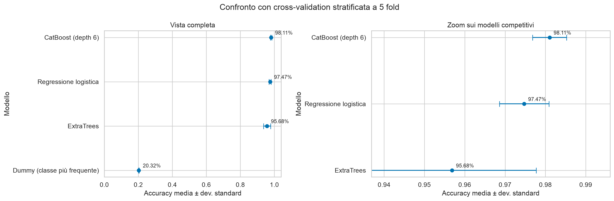
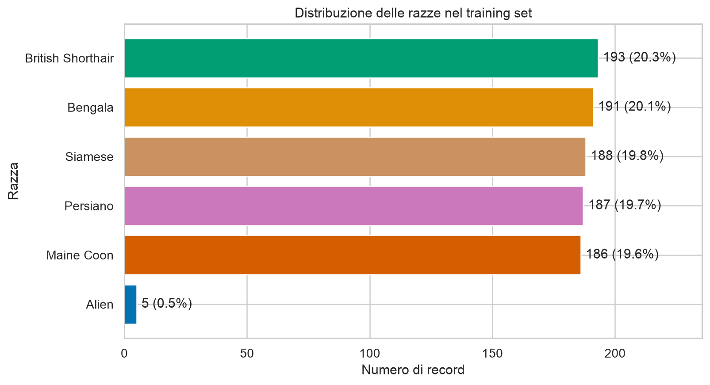
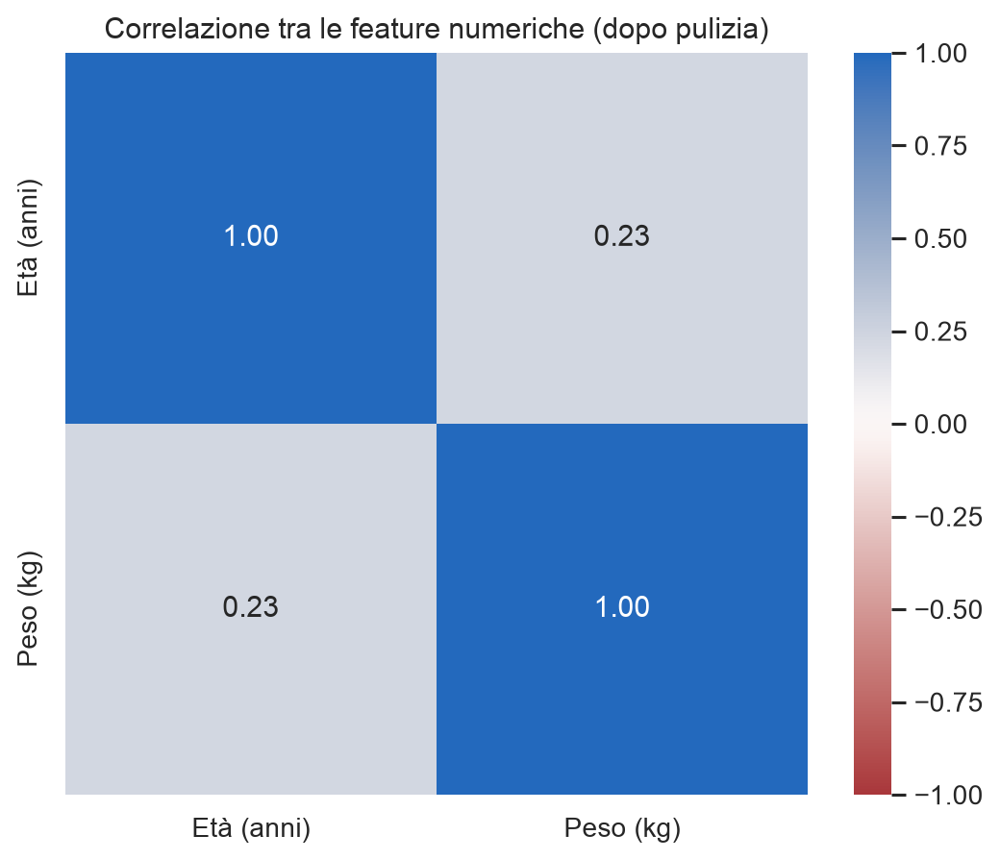
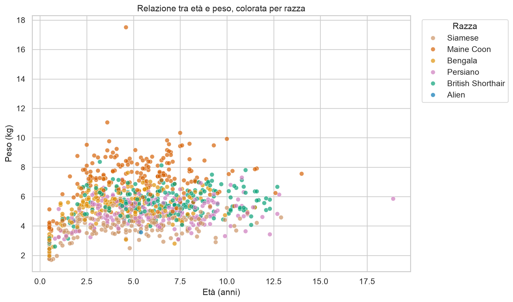
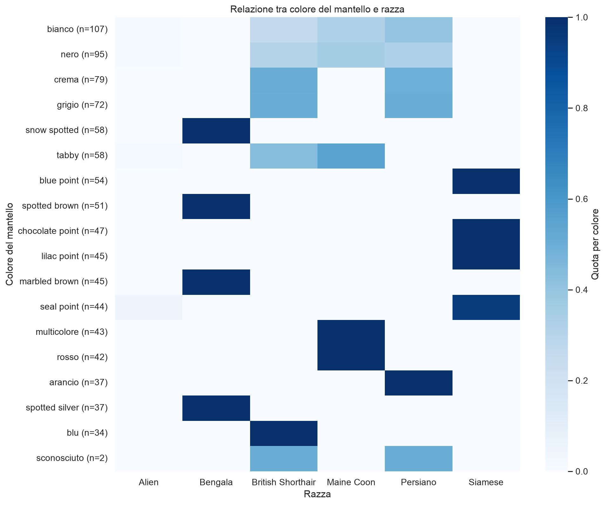
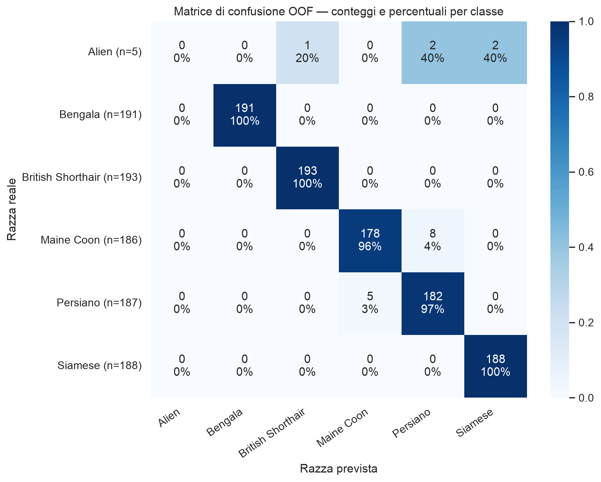
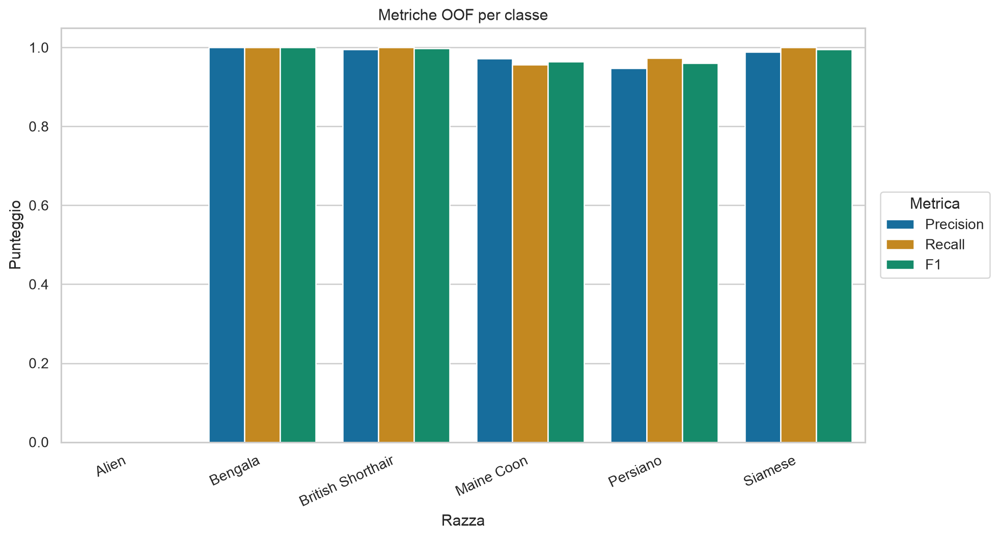
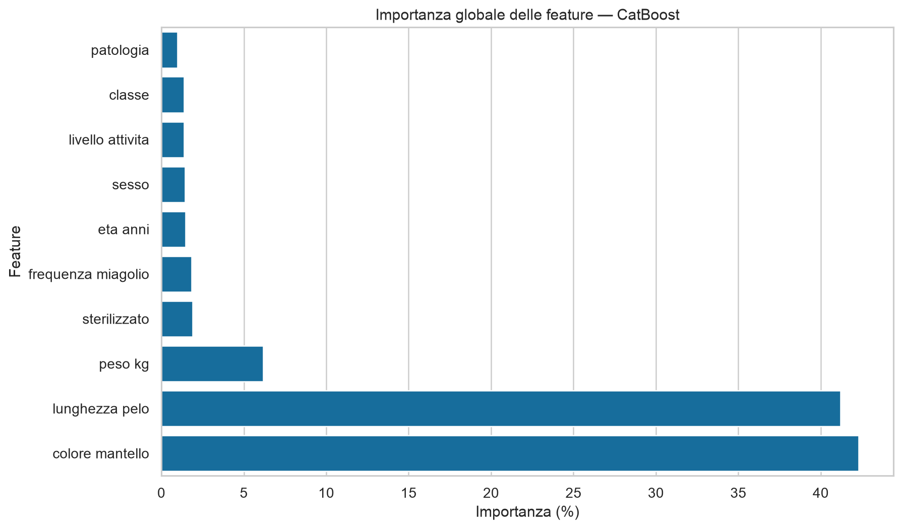

# cat-classifier-marilli

Soluzione prima challenge estiva Hackersgen PRO Premio Marilli 2026. Il progetto carica e pulisce i CSV, confronta più modelli e genera `predictions.csv` per i 50 record del test set.

## Risultato

Il modello finale è **CatBoost depth 6**.

| Misura | Risultato |
|---|---:|
| Accuracy OOF (5 fold) | **98,11%** |
| Accuracy media sui 15 fold (3 seed) | **98,18% ± 0,33%** |
| Balanced accuracy | **82,23%** |
| Macro-F1 | **82,01%** |
| Weighted-F1 | **97,92%** |

La seconda riga e le tre metriche successive sono calcolate sui 15 fold complessivi, usando tre seed diversi. La deviazione standard descrive la variabilità tra fold.

### Confronto dei modelli

| Modello | Accuracy | Dev. standard | Macro-F1 |
|---|---:|---:|---:|
| CatBoost depth 6 | **98,11%** | 0,42% | 81,96% |
| Regressione logistica | 97,47% | 0,61% | 81,43% |
| ExtraTrees | 95,68% | 2,09% | 80,00% |
| Dummy classifier | 20,32% | 0,26% | 5,63% |



Il dummy classifier serve come baseline. La regressione logistica è già molto competitiva, mentre ExtraTrees offre un secondo confronto ad alberi. CatBoost gestisce direttamente feature categoriche e valori mancanti [1] e ottiene il risultato migliore, ma il margine sulla regressione logistica è contenuto. I modelli ad albero sono inoltre un riferimento solido per dati tabulari di queste dimensioni [2].

La ricerca degli iperparametri rimane compatta, vista la dimensione del dataset. Vengono variati profondità, learning rate, numero di iterazioni, regolarizzazione L2 e complessità delle combinazioni categoriche. Le due configurazioni migliori sullo split iniziale vengono poi controllate con i seed 42, 123 e 2026. La ricerca completa è in [`reports/ricerca_catboost.csv`](reports/ricerca_catboost.csv), mentre il confronto finale delle due candidate è in [`reports/tuning_catboost.csv`](reports/tuning_catboost.csv).

## Dati e pulizia

Il dataset contiene 950 record di training e 50 di test. Nel file di training sono presenti:

- una riga finale incompleta (`951,`), priva di feature e target;
- una riga con un solo valore numerico al posto di età e peso;
- pesi di 487 e 646 kg e un'età di 52 anni;
- celle mancanti, typo e categorie non valide come `arcobaleno` e `forse`;
- 5 record con target `Alien`.

La riga ambigua viene conservata, ma età e peso sono impostati come mancanti. Anche i valori fuori da limiti plausibili vengono trattati come mancanti.

I cinque record etichettati come `Alien` hanno caratteristiche eterogenee e compatibili con razze ordinarie. È molto probabile che rappresentino un'anomalia del target, ma non ci sono informazioni sufficienti per correggerli. I record non vengono quindi modificati.

`classe` e `livello_attivita` usano le stesse categorie e coincidono nell'89,47% dei record, ma non sono duplicati, nel training ci sono 100 casi discordanti. Sono mantenute entrambe perché nelle prove sul modello finale rimuovere `classe` porta l'accuracy OOF dal 98,11% al 97,89%, mentre rimuovere `livello_attivita` la porta al 97,79%.

## Validazione

Il confronto iniziale usa una cross-validation stratificata a 5 fold. Il preprocessing dei modelli scikit-learn è incluso nella pipeline, quindi imputazione, scaling e one-hot encoding vengono appresi solo sulla parte di training del singolo fold.

Le due configurazioni CatBoost vengono poi confrontate ripetendo la validazione con i seed 42, 123 e 2026. In questo modo la scelta non dipende da una sola suddivisione dei dati. Per ogni esecuzione vengono salvate accuracy, balanced accuracy, macro-F1 e weighted-F1.

La matrice di confusione e il report per classe usano predizioni out-of-fold: ogni riga è quindi predetta da un modello che non l'ha usata durante l'addestramento. Questi due artefatti usano lo split con seed 42; le metriche riepilogative iniziali sono invece medie sui tre seed.

## Grafici

### Distribuzione delle razze



Le cinque razze principali sono quasi bilanciate.

### Correlazioni numeriche



La matrice usa soltanto età e peso.

### Relazione tra età e peso



Il peso separa parzialmente alcune razze, ma rimane una forte sovrapposizione.

### Colore del mantello e razza



La heatmap mostra la distribuzione delle razze per colore. Accanto a ogni colore è riportato anche il numero di esempi.

### Matrice di confusione



Gli errori delle classi principali sono soprattutto tra Maine Coon e Persiano.

### Metriche per classe



### Importanza delle feature



Lunghezza e colore del mantello sono le feature più usate dal modello finale. I valori completi sono in [`reports/importanza_feature.csv`](reports/importanza_feature.csv).

## Esecuzione

Richiede Python 3.11 o successivo e `uv`.

```bash
uv sync --locked
uv run python -m src.train_final
```

La pipeline rigenera `predictions.csv`, i CSV nella cartella `reports/` e i grafici.

### Test

```bash
uv run pytest -q
uv run ruff check .
uv run ruff format --check .
```

I test controllano caricamento e pulizia dei dati, cross-validation, preprocessing, formato della submission e il file finale incluso nella repository.

## Struttura

```text
data/                 dataset di training e test
grafici/              grafici generati dalla pipeline
reports/              metriche e predizioni out-of-fold
src/data.py           caricamento e pulizia
src/models.py         modelli e cross-validation
src/plots.py          grafici
src/submission.py     costruzione e controllo della submission
src/train_final.py    pipeline completa
tests/                test automatici
pyproject.toml        dipendenze e configurazione degli strumenti
uv.lock               versioni risolte per un ambiente riproducibile
predictions.csv       submission finale
```

## Riferimenti

[1] L. Prokhorenkova, G. Gusev, A. Vorobev, A. V. Dorogush, A. Gulin,
“CatBoost: Unbiased Boosting with Categorical Features Support.” 2018.

[2] L. Grinsztajn, E. Oyallon, G. Varoquaux,
“Why Do Tree-Based Models Still Outperform Deep Learning on Typical Tabular Data?” 2022.
